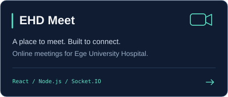
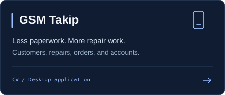
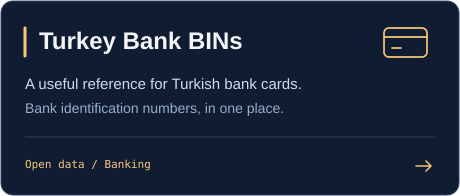
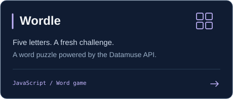

 

**[Portfolio](https://harunbulbul.com)** &nbsp; / &nbsp; **[LinkedIn](https://www.linkedin.com/in/harun-b%C3%BClb%C3%BCl/)** &nbsp; / &nbsp; **[Email](mailto:harun@harunbulbul.com)**

 

I build for the web, with an eye for design and a love for the details. From the first interface to the API behind it, I enjoy making the pieces work together.

 

## A little about me

I'm **Harun**, a full stack developer based in **Ankara, Türkiye**, working at **Obiziz Digital Communication**. I like building useful software that feels good to use.

- **On the screen:** considered interfaces, responsive layouts, and thoughtful interactions.
- **Behind the scenes:** APIs, databases, and the logic that keeps everything connected.
- **Beyond the browser:** mobile apps, developer tools, and creative experiments.

## My toolkit

| Where I work | What I work with |
| :--- | :--- |
| **Interfaces** | `JavaScript` · `TypeScript` · `React` · `Next.js` · `Vue` · `Angular` |
| **Style & interaction** | `HTML` · `CSS` · `Tailwind CSS` · `Bootstrap` · `Figma` |
| **Servers & APIs** | `Node.js` · `Express` · `NestJS` · `PHP` · `Laravel` · `Python` · `Django` · `.NET` |
| **Data & infrastructure** | `MongoDB` · `MySQL` · `SQLite` · `Firebase` · `Docker` · `Linux` |
| **Everyday tools** | `Git` · `GitHub` · `VS Code` · `Postman` · `Photoshop` |

## Things I've built

<a href="https://github.com/HarunBulbull?tab=repositories">Explore my repositories ↗</a>

## A year, one square at a time

My GitHub contributions, with a little more movement.

<picture>
  <source media="(prefers-color-scheme: dark)" srcset="./assets/github-snake-dark.svg" />
  <source media="(prefers-color-scheme: light)" srcset="./assets/github-snake.svg" />
  
</picture>

Regenerated daily with <a href="https://github.com/HarunBulbull/HarunBulbull/actions/workflows/snake.yml">GitHub Actions</a> · Animation by <a href="https://github.com/Platane/snk">snk</a>

---

### Have something in mind?

Let's turn it into something you can use.

**[harun@harunbulbul.com](mailto:harun@harunbulbul.com)**

Made with care, from Ankara.

